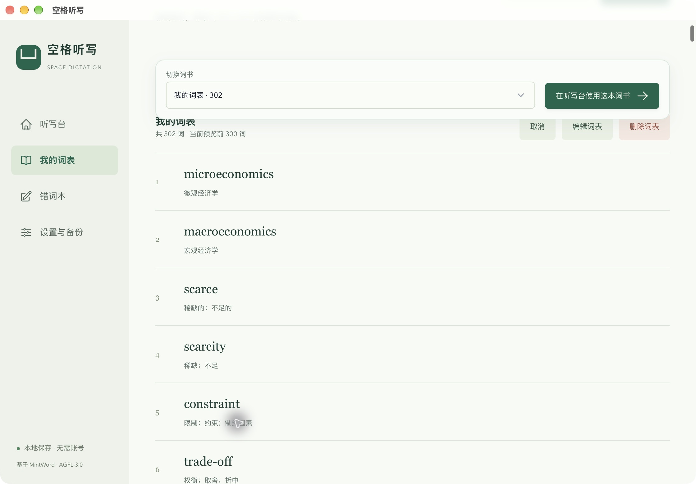

# 空格听写 · 真实界面展示

以下海报使用真实应用截图和安装包实际图标。截图仅裁去系统标题栏并缩放排版，应用内的界面、按钮与文字未重绘。截图使用演示词表与独立数据目录，个人词表、目录和数量因用户而异。

## 听写台

按一次空格进入一个新词，R 重读；听写时隐藏英文与释义。

## 词表与实际功能

支持个人词表、四级、六级、雅思；豆包／ChatGPT 双版收词提示词；提前缓存标准发音、缺音时自己录制、核对和错词重练。

## 平台安装

图中是 macOS 真实界面。提供 Mac Apple 芯片和 Windows x64 安装包，系统授权提示以实际平台为准。

## 两种 Mac 首次打开方法与一键复制

图片不能点击复制命令。请阅读 [完整安装指南](MAC-INSTALL.md)，使用 GitHub 文字代码块右上角的复制按钮，或下载 [带复制按钮的安装帮助页](https://github.com/zhang-jincheng/space-dictation/releases/latest/download/Mac-Install-Guide.html) 在浏览器中打开。

## 原始真实截图

