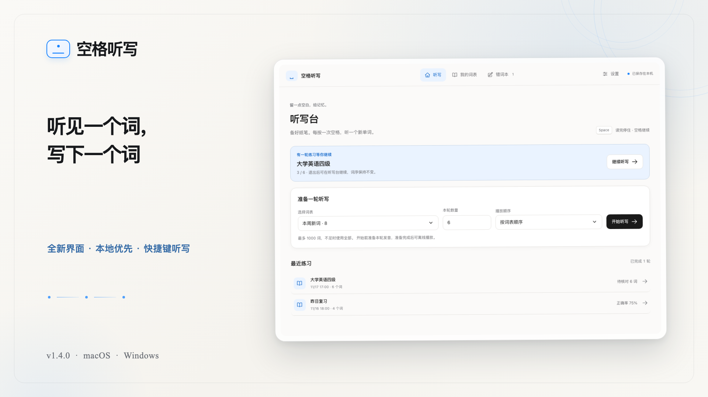
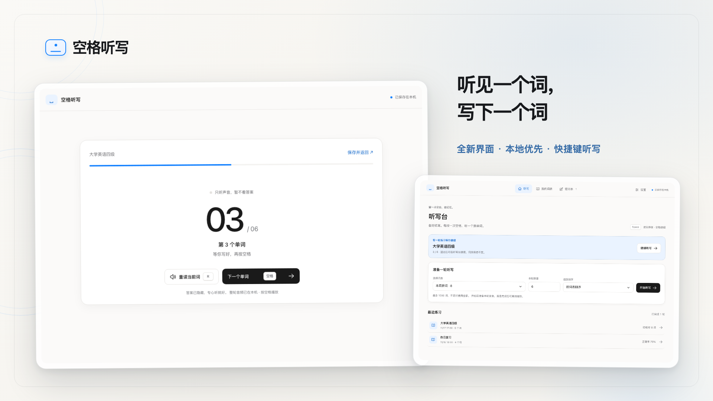

# 空格听写 v1.4.0

## 本版变化

- 全面更新应用界面，以暖白纸面、清晰蓝色强调和舒展留白为主；导航移到顶部，听写台突出选词、轮次设置与最近练习。
- 保留亮色、暗色与跟随系统三种外观，并支持系统的减少动态效果设置。
- 个人录音窗口可在合适尺寸的窗口内拖动或用方向键微调，可随时回到居中位置；窗口较小时保持居中。
- 改进录音窗口的键盘焦点管理、关闭后的焦点恢复，以及录音失败时的提示。
- 继续保留按 Space 逐词听写、按 R 重读、听写时隐藏答案、个人词表、错词重练与本地备份。

## 下载与更新

- macOS Apple 芯片：下载 DMG，将应用放入“应用程序”。已安装 v1.3.0 及以上版本可在应用内更新。
- Windows x64：下载 `-setup.exe`；已有版本可在应用内更新。
- `.app.tar.gz`、`.sig` 和 `latest.json` 供应用自动更新使用，不需要手动打开。
- 更新包有签名校验；这不代表已完成 Apple 正式公证或 Windows 发布者代码签名。

## 新版海报

